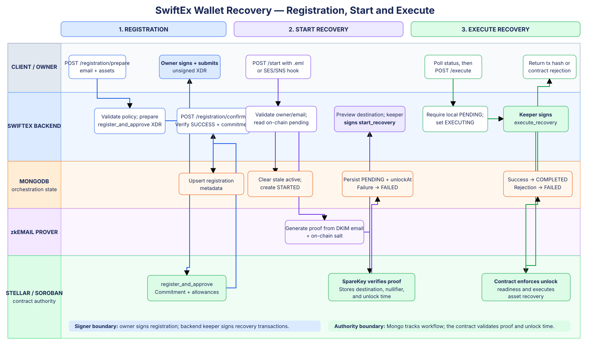

# 🔐 SwiftEx Wallet Recovery Backend: zkEmail Recovery on Stellar

[](https://nestjs.com)
[](https://developers.stellar.org)
[](./Architecture.md#-proof-generation-pipeline)
[](./Architecture.md#-signing-and-trust-boundaries)

> **SwiftEx Wallet Recovery Backend** is the NestJS module that prepares owner-signed recovery registration and cancellation transactions, turns a DKIM-signed recovery email into a zero-knowledge proof, submits keeper-signed recovery operations to Stellar, persists recovery state, and sends best-effort notifications.

This is the central documentation page for the recovery module. Use the links below for system design, environment and circuit setup, and the complete registration-to-execution walkthrough.

> [!IMPORTANT]
> This directory is a feature module inside `swift-ex-proxy-server`, not a standalone service. Install, configure, and run commands from the repository root.

---

## 📚 Documentation Index

| Document                                                          | Description                                                                                                      |
| :---------------------------------------------------------------- | :--------------------------------------------------------------------------------------------------------------- |
| 🏗️ [**Architecture & Integration Guide**](Architecture.md)       | Components, persistence, authentication, proof pipeline, Stellar calls, state transitions, and trust boundaries |
| ⚙️ [**Installation & Setup Guide**](Installation.md)              | Backend configuration, circuit generation, ceremony requirements, verifier deployment, startup, and validation  |
| 🚀 [**Backend API Walkthrough & Demo Guide**](DemoGuide.md)       | Registration, recovery start, status, execution, cancellation, SES ingestion, and failure checks                |

---

## 🔄 End-to-End Recovery Flow



[Open the editable Draw.io source](docs/recovery-flow.drawio)

---

## 💡 What This Module Does

1. **Prepare registration:** Builds unsigned Soroban XDR containing an email commitment, salt, protected assets, floors, allowance, and expiry ledger.
2. **Confirm registration:** Verifies the owner-signed transaction finalized successfully and matches the supplied email before storing delivery metadata.
3. **Prove recovery intent:** Accepts a DKIM-signed `.eml` directly or through the SES/SNS hook and generates a zkEmail proof.
4. **Start recovery:** Uses the configured keeper account to submit `start_recovery` and persists the destination and contract timelock.
5. **Track and execute:** Returns the latest stored attempt, then submits `execute_recovery` after the contract allows it.
6. **Cancel recovery:** Prepares owner-signed `cancel_recovery` XDR and confirms the finalized transaction.

```text
Owner/device ── prepare + sign registration ──> Stellar SpareKey contract
      │                                                 │
      └── confirm tx ──> Mongo registration             │
                                                        │
Signed email ──> zkEmail proof ──> keeper start ──> timelock
                                                        │
Client status polling <── Mongo attempt <── keeper execute
```

---

## 🔌 API Summary

Base path: `/api/v1/recovery`

| Method | Path                    | Purpose                                                     | Signer                 |
| :----- | :---------------------- | :---------------------------------------------------------- | :--------------------- |
| `POST` | `/registration/prepare` | Return unsigned registration XDR                            | Owner signs            |
| `POST` | `/registration/confirm` | Verify finalized registration and save metadata             | Already owner-signed   |
| `POST` | `/registration`         | Save registration metadata only; does not register on-chain | None                   |
| `POST` | `/start`                | Upload `.eml`, generate proof, and start recovery           | Backend keeper         |
| `GET`  | `/:owner`               | Return the latest persisted attempt                         | None                   |
| `POST` | `/execute`              | Execute a pending recovery                                  | Backend keeper         |
| `POST` | `/cancel/prepare`       | Return unsigned cancellation XDR                            | Owner signs            |
| `POST` | `/cancel/confirm`       | Verify cancellation and update local attempt state          | Already owner-signed   |
| `POST` | `/ses-hook`             | Receive SNS subscription/SES notifications                  | Infrastructure webhook |

All routes except `/ses-hook` require an authenticated Stellar wallet, and the wallet in the request must match the route/body owner. Registration metadata writes also require authenticated device context. See [Authentication](./Architecture.md#-authentication-and-route-ownership).

> [!CAUTION]
> `/ses-hook` is intentionally exempt from wallet authentication. The controller currently parses SNS-shaped payloads but does not verify an AWS SNS signature. Restrict and validate this route at the deployment boundary before production exposure.

---

## ⚡ Quick Start

From the proxy-server repository root:

```bash
npm install
cp .env.example .env

# Configure MongoDB, Redis, JWT, Stellar recovery contracts/keeper,
# and all zkEmail circuit artifacts before exercising recovery.
npm run start:dev
```

The server listens on `PORT` or `3000` by default. Swagger UI is available at `/docs` and its JSON document at `/docs-json`; controller decorators determine how much route detail appears there.

For the complete setup, use the [Installation & Setup Guide](./Installation.md). For request examples, use the [Backend API Walkthrough](./DemoGuide.md).

---

## 🔧 Recovery Configuration at a Glance

| Area                 | Main settings                                                                                                                            |
| :------------------- | :--------------------------------------------------------------------------------------------------------------------------------------- |
| Keeper and contracts | `SWIFTEX_RECOVERY_KEEPER_SECRET`, `SWIFTEX_SPAREKEY_ID`, `SWIFTEX_ZK_VERIFIER_ID`, `SWIFTEX_RECOVERY_XLM_SAC`                            |
| Stellar network      | `SWIFTEX_RECOVERY_RPC_URL`, `SWIFTEX_NETWORK_PASSPHRASE`                                                                                 |
| Registration policy  | `SWIFTEX_RECOVERY_FLOOR`, `SWIFTEX_RECOVERY_EXPIRY_LEDGERS`                                                                              |
| Circuit selection    | `SWIFTEX_CIRCUIT_DIR`, `SWIFTEX_CIRCUIT`                                                                                                 |
| Proof artifacts      | `SWIFTEX_PROVING_KEY`, `SWIFTEX_WASM`, `SWIFTEX_WITNESS_GENERATOR`, `SWIFTEX_PROVER`, `SWIFTEX_INPUT_GENERATOR`, `SWIFTEX_PROOF_ENCODER` |
| Temporary work       | `SWIFTEX_RECOVERY_TEMP`                                                                                                                  |

Never commit keeper secrets, JWT secrets, database credentials, raw recovery emails, witness data, or proof work directories.

---

## 🧪 Tests

```bash
# Recovery module suites
npm test -- --runInBand --no-watchman src/api/v1/recovery

# TypeScript build
npm run build

# Full project suite
npm test -- --runInBand --no-watchman
```

The recovery suites cover controller ownership checks, state transitions, transaction preparation rules, registration persistence, configuration path resolution, `.eml` validation, and SES/SNS parsing with mocked dependencies. They do not prove that a deployed circuit, contract, RPC endpoint, email pipeline, or live asset sweep works.

---

## ✅ Scope

| Included here                                         | External dependency                                                          |
| :---------------------------------------------------- | :--------------------------------------------------------------------------- |
| Recovery API controllers and orchestration            | SwiftEx mobile/API caller                                                    |
| MongoDB registration and attempt records              | MongoDB service                                                              |
| zkEmail proof-process invocation                      | Compiled circuit, proving key, witness generator, and prover                 |
| Stellar transaction preparation and keeper submission | Soroban RPC, funded keeper, SpareKey and verifier contracts                  |
| Best-effort Firebase notifications                    | Firebase configuration and reachable devices                                 |
| SES/SNS payload ingestion                             | AWS SES receipt rule, SNS topic, delivery controls, and signature validation |

<p align="center">
  Backend recovery orchestration for <strong>SwiftEx</strong> on <strong>Stellar</strong>.<br/>
  Owner-controlled registration; keeper-submitted proof and execution.
</p>
